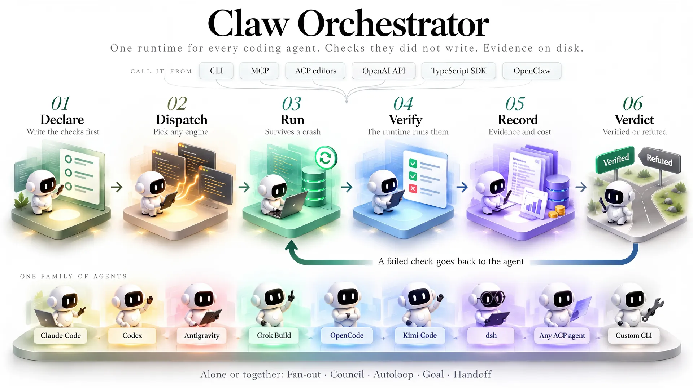
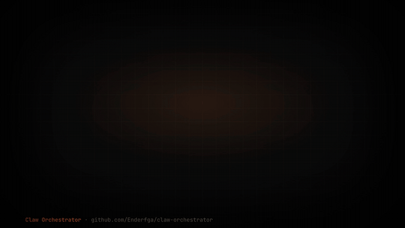

<p align="center"></p>

<h1 align="center">Claw Orchestrator: A Unified Runtime for Coding Agent CLIs</h1>

<p align="center">
  📦 <a href="https://www.npmjs.com/package/@enderfga/claw-orchestrator">npm</a> •
  📖 <a href="./skills/references/getting-started.md">Documentation</a> •
  🎬 <a href="./examples/promo-video/">Demo film</a> •
  📝 <a href="./CHANGELOG.md">Changelog</a> •
  📚 <a href="#citation">Citation</a>
</p>

<p align="center">
  <a href="https://www.npmjs.com/package/@enderfga/claw-orchestrator"></a>
  <a href="https://www.npmjs.com/package/@enderfga/claw-orchestrator"></a>
  <a href="https://github.com/Enderfga/claw-orchestrator/actions/workflows/ci.yml"></a>
  <a href="./LICENSE"></a>
</p>

**Claw Orchestrator** runs Claude Code, Codex, Antigravity, Grok Build, OpenCode and any
[Agent Client Protocol](https://agentclientprotocol.com) agent (Kimi Code, dsh) as persistent sessions behind one API.
A run counts as done only when checks the agent did not write pass: you declare the checks, the runtime runs them
and reads the exit codes, and the evidence stays on disk. Runs are checkpointed workflows that survive a crash, and
every turn on every engine is recorded with its model, tokens and cost.

<p align="center">
  
</p>

<p align="center"><sub>
One bug, one acceptance contract, five engines, three runs each, first attempt only. The runtime ran the checks itself:
9 verified, 4 refuted, 2 errored (Grok Build hit its free-tier usage limit). One task, not a benchmark.
<a href="./examples/promo-video/">How the film was made, and how to re-run it</a>.
</sub></p>

<details>
<summary><b>The 40-second film, with sound</b></summary>

https://github.com/user-attachments/assets/5bf9bea8-e5ac-4632-a292-a80a45831dff

</details>

## News

- **[2026-10]** v7.16.0: `clawo goal --engine claude` runs a goal on Claude Code's `/goal`, with the same
  checkpointing, resume and verification as a Codex goal.
- **[2026-10]** [ResearchBoost-Agent](https://github.com/AI4AI-for-Anything/ResearchBoost-Agent), an autonomous agent
  that profiles, optimizes and validates AI training code, now runs its goal mode on Claw Orchestrator.
- **[2026-10]** v7.14.0: any Agent Client Protocol agent runs as a session (`engine: 'acp'`), with presets for
  Kimi Code and dsh.
- **[2026-10]** v7.13.0: `clawo goal` keeps a Codex `/goal` running for hours on one thread, reattaches it after a
  crash, and judges the result with your checks.
- **[2026-09]** [Declare, Compile, Look](https://openreview.net/forum?id=Romd50Ce0w), built on Claw Orchestrator,
  was presented as a talk at the ECCV 2026 Workshop on Multimodal Digital Agents.
- **[2026-08]** v6.0.0: the durable run kernel and the verification plane. A run survives its own process dying, and
  a run with an acceptance contract is judged by the runtime, not by the agent.

## Highlights

- ✅ **Verdicts the agent cannot write**: acceptance contracts (commands, HTTP probes, screenshots, diff policy, file
  assertions) run by the runtime. A run ends `verified`, `refuted` or `unverified`, and editing the tests its contract
  runs refutes it ([guide](./skills/references/verification.md)).
- 🔀 **Many vendors, one API**: Claude Code, Codex, Antigravity, Grok Build, OpenCode, any ACP agent and custom CLIs.
  `clawo fanout` asks several at once; `session_handoff` moves a live conversation to another engine in the same
  workspace ([guide](./skills/references/multi-engine.md)).
- 💾 **Survives a crash**: every state transition is checkpointed; resume, retry, timeout, cancel and steer come from
  the kernel ([guide](./skills/references/workflow.md)).
- 🎯 **Long goals**: `clawo goal` runs a Codex `/goal` unattended on one thread, resumes it after usage limits within a
  bound, optionally inside your own sandbox ([guide](./skills/references/workflow.md#goal)).
- 💰 **Known cost**: one per-turn ledger across engines (`clawo runs`) and a `maxBudgetUsd` cap the runtime enforces on
  every engine ([guide](./skills/references/observability.md)).
- 🔌 **Fits your tools**: a CLI, an MCP server, an ACP agent for editors, an OpenAI-compatible endpoint, a TypeScript
  SDK and an OpenClaw plugin ([ways to run](#ways-to-run)).

claude-squad, Conductor and Vibe Kanban are interfaces for running agents side by side in worktrees; Claude Code
subagents and Codex's parallel attempts stay within one vendor. Claw Orchestrator is a headless runtime underneath:
several vendors behind one API, durable workflows, and a verification step the agents cannot edit. They can be used
together.

## Quick Start

Requires Node 22+ and at least one engine CLI installed and logged in (`claude`, `codex`, `agy`, `grok` or `opencode`).

```bash
npm install -g @enderfga/claw-orchestrator
clawo serve &    # local runtime + dashboard on 127.0.0.1:18796
```

```bash
clawo solve "The test fails. Fix price.js." --engine codex \
  --check "npm test" --check "node ../holdout/price.spec.mjs" --wait
clawo verify <runId>    # each check, why it failed, the files that changed
clawo runs --since 1h   # every turn on every engine: model, tokens, cost, verdict
```

```bash
clawo fanout "How would you speed up this test suite?" --engines claude,codex,grok --synthesize --wait
clawo goal --objective-file GOAL.md --check "npm run bench:check" --check-timeout 120 --wait
```

The server writes an access token to `~/.openclaw/server-token` and the CLI reads it from there. To sign in the
browser once, open `http://127.0.0.1:18796/login?token=<token>&redirect=/dash`.

- 🧪 **Acceptance contracts and evidence bundles** ([guide](./skills/references/verification.md))
- 🔁 **Workflows, resume and the goal node** ([guide](./skills/references/workflow.md))
- 🖥️ **Every CLI command** ([guide](./skills/references/cli.md))
- 🧰 **All 78 tools** ([guide](./skills/references/tools.md))

## Ways to run

|                                | For                                                                                       | Start here                                                                        |
| ------------------------------ | ----------------------------------------------------------------------------------------- | --------------------------------------------------------------------------------- |
| **CLI and dashboard**          | Terminals and scripts                                                                     | `clawo serve`, then [`cli.md`](./skills/references/cli.md)                        |
| **MCP server**                 | Claude Code, Claude Desktop, Cursor, Cline, Continue, Zed, Windsurf, Goose, Hermes Agent | `claude mcp add clawo -- clawo-mcp`, then [`mcp.md`](./skills/references/mcp.md)  |
| **ACP agent**                  | Zed, JetBrains, Neovim, Emacs, the VS Code ACP extension, dsh                             | `clawo acp`, then [`acp.md`](./skills/references/acp.md)                          |
| **OpenAI-compatible endpoint** | Any OpenAI SDK client or webchat, without changing call sites                             | `POST /v1/chat/completions` ([`openai-compat.md`](./skills/references/openai-compat.md)) |
| **TypeScript SDK**             | Embedding the runtime in your own service                                                 | `import { SessionManager } from '@enderfga/claw-orchestrator'` (below)            |
| **OpenClaw plugin**            | Every OpenClaw agent gets all 78 tools                                                    | `curl -fsSL https://raw.githubusercontent.com/Enderfga/claw-orchestrator/main/install.sh \| bash` |

```ts
import { SessionManager } from '@enderfga/claw-orchestrator';

const manager = new SessionManager();
await manager.startSession({ name: 'fix-tests', engine: 'claude', cwd: '/project' });
const result = await manager.sendMessage('fix-tests', 'Fix the failing tests');
```

From an MCP host, ask for `workflow_start` with template `solve`, a task, and a contract such as
`{"checks":[{"type":"command","cmd":"npm","args":["test"]}]}`. In an ACP editor, the model selector is grouped by
engine, so one dropdown switches between Claude, Codex, Antigravity and Grok models mid-session.

## Engine compatibility

| Engine      | CLI        | Tested version                  |
| ----------- | ---------- | ------------------------------- |
| Claude Code | `claude`   | 2.1.310                         |
| Codex       | `codex`    | 0.164.0                         |
| Antigravity | `agy`      | 1.4.6                           |
| Grok Build  | `grok`     | 1.0.70                          |
| OpenCode    | `opencode` | 1.19.4                          |
| ACP agent   | any        | Kimi Code 2.3.1, dsh 0.2.1-rc.2 |
| Custom CLI  | any        | —                               |

An agent that serves the Agent Client Protocol on stdio runs as
[`engine: 'acp'`](./skills/references/multi-engine.md#acp-agents-engine-acp); any other coding CLI that runs as a
subprocess can be wired up as a [custom engine](./skills/references/multi-engine.md#custom-engine-engine-custom).

<details>
<summary><b>How the table stays current</b></summary>

The versions above are what the weekly sweep last ran. `scripts/sweep.ts` measures each core engine's installed,
pinned and upstream version, diffs the flags the wrapper passes against the binary's `--help`, runs one live turn
**through the real wrapper class**, smokes the ACP and MCP entry points, and checks `src/models.ts` against the
OpenAI, Anthropic and xAI published price tables. It contains no model call, so the check that reports a wrapper as broken does not
share the wrapper's failure modes.

`scripts/sweep-workflow.json` wraps the same script as a durable run on this project's own kernel: verifier → router
→ an agent that drafts the alignment on a `sweep/<date>` branch → a human gate. A person reviews and merges; the
orchestrator does not edit its own code unattended.

</details>

## All features

| Capability                  | What it does                                                                                                                  | Reference                                                   |
| --------------------------- | ----------------------------------------------------------------------------------------------------------------------------- | ----------------------------------------------------------- |
| **Persistent sessions**     | Long-lived agents kept alive across requests, with context, tool, model and worktree control.                                 | [`sessions.md`](./skills/references/sessions.md)            |
| **Multi-engine runtime**    | One interface over the engines above, any ACP agent, and custom CLIs.                                                         | [`multi-engine.md`](./skills/references/multi-engine.md)    |
| **Session handoff**         | Moves a live conversation to another engine or model in the same workspace; the old session keeps running.                   | [`sessions.md`](./skills/references/sessions.md)            |
| **Verification plane**      | Acceptance contracts the runtime runs itself, with an evidence bundle on disk; a run without a contract ends `unverified`.    | [`verification.md`](./skills/references/verification.md)    |
| **Durable run kernel**      | Declarative workflows over `agent`, `goal`, `fanout`, `council`, `verifier`, `human_gate`, `router` and more, checkpointed.   | [`workflow.md`](./skills/references/workflow.md)            |
| **Fan-out**                 | One task across N engine/model agents in parallel, with an optional synthesis pass.                                           | [`tools.md`](./skills/references/tools.md)                  |
| **Council**                 | Parallel agents in isolated git worktrees, voting until they reach consensus.                                                 | [`council.md`](./skills/references/council.md)              |
| **Autoloop**                | A Planner, Coder and Reviewer iterating on a workspace, each with its own engine and model; you chat with the Planner.        | [`autoloop.md`](./skills/references/autoloop.md)            |
| **Ultraapp**                | A short structured interview turned into a deployed web app at `localhost:19000/forge/<slug>/`.                               | [`ultraapp.md`](./skills/references/ultraapp.md)            |
| **ultracode**               | `session_start({ ultracode: true })` lets Claude orchestrate a dynamic workflow of subagents.                                 | [`tools.md`](./skills/references/tools.md)                  |
| **Run ledger, spend caps**  | Every turn on every engine in one JSONL ledger (`clawo runs`), and a `maxBudgetUsd` cap enforced on every engine.             | [`observability.md`](./skills/references/observability.md)  |
| **OpenAI-compatible proxy** | `POST /v1/chat/completions` routed to persistent sessions on the engine the model name selects, streamed back in OpenAI shape. | [`openai-compat.md`](./skills/references/openai-compat.md) |
| **Dashboard**               | Autoloop, Council and Forge tabs with lifecycle controls and live event streams, and a Runs tab of durable workflow runs.      | [`dashboard.md`](./skills/references/dashboard.md)          |

## Built on Claw Orchestrator

- [ResearchBoost-Agent](https://github.com/AI4AI-for-Anything/ResearchBoost-Agent): an autonomous agent that profiles,
  optimizes and validates AI training code; its long goal-mode runs use `clawo goal`
  ([blog](https://ydove0324.github.io/hx_resume/blog/researchboost/)).
- [Declare, Compile, Look](https://openreview.net/forum?id=Romd50Ce0w): coordinate-free layout generation with
  vision-in-the-loop repair, ECCV 2026 Workshop on Multimodal Digital Agents (talk).

Using Claw Orchestrator in a project or paper? Open a pull request to add it here.

## Citation

If Claw Orchestrator helps your research, please cite it:

```bibtex
@misc{fang2026claworchestrator,
  title        = {Claw Orchestrator: A Unified Runtime for Coding Agent CLIs},
  author       = {Fang, Guian},
  year         = {2026},
  howpublished = {\url{https://github.com/Enderfga/claw-orchestrator}}
}
```

Research built on Claw Orchestrator:

```bibtex
@misc{researchboost2026infra,
  author = {{ResearchBoost Team}},
  title  = {{ResearchBoost}: {RSI} starts with Infra},
  year   = {2026},
  url    = {https://ydove0324.github.io/hx_resume/blog/researchboost/}
}

@inproceedings{fang2026declare,
  title     = {Declare, Compile, Look: Coordinate-Free Layout Generation with Vision-in-the-Loop Repair},
  author    = {Fang, Guian and Liu, Mengsha and Shou, Mike Zheng},
  booktitle = {ECCV 2026 Multimodal Digital Agents Workshop},
  year      = {2026},
  url       = {https://openreview.net/forum?id=Romd50Ce0w}
}
```

## Contributing

See [`CONTRIBUTING.md`](./CONTRIBUTING.md). Run `npm run build && npm run lint && npm run format:check && npm run test`
before submitting.

## License

MIT, see [`LICENSE`](./LICENSE).
